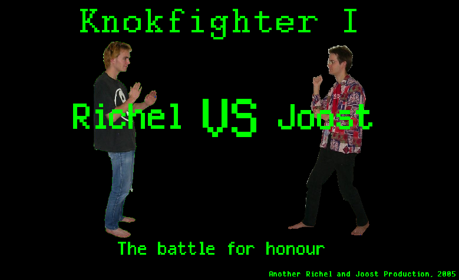
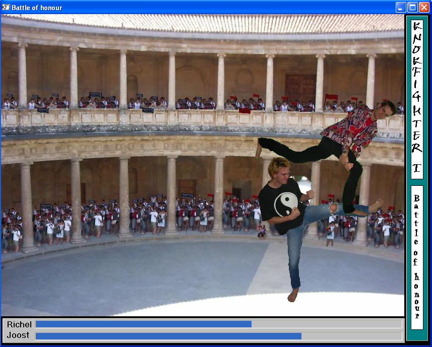
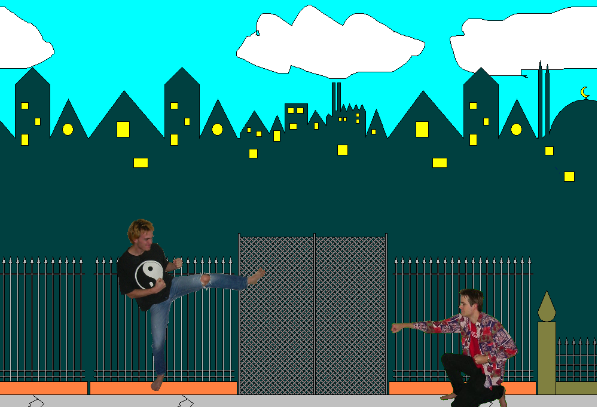

# KnokFighter

The game KnokFighter using the C++ VCL library.

Programmed by Joost van den Bogaart and Richel Bilderbeek.

- [Storyline (pdf)](KnokFighterStory_1_0.pdf)
- [Storyline (ppt)](KnokFighterStory_1_0.ppt)

